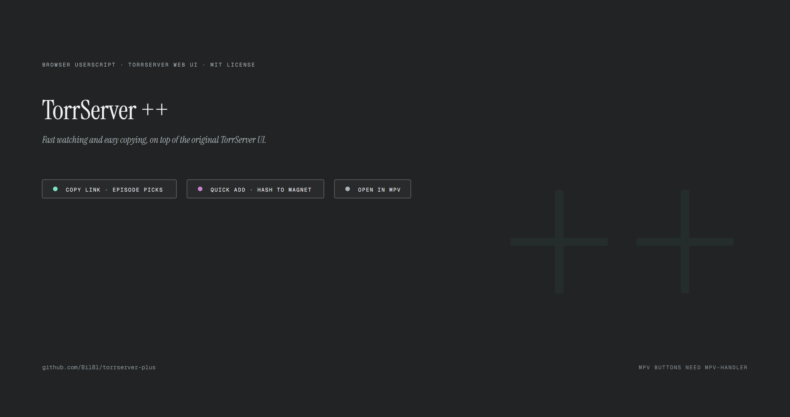
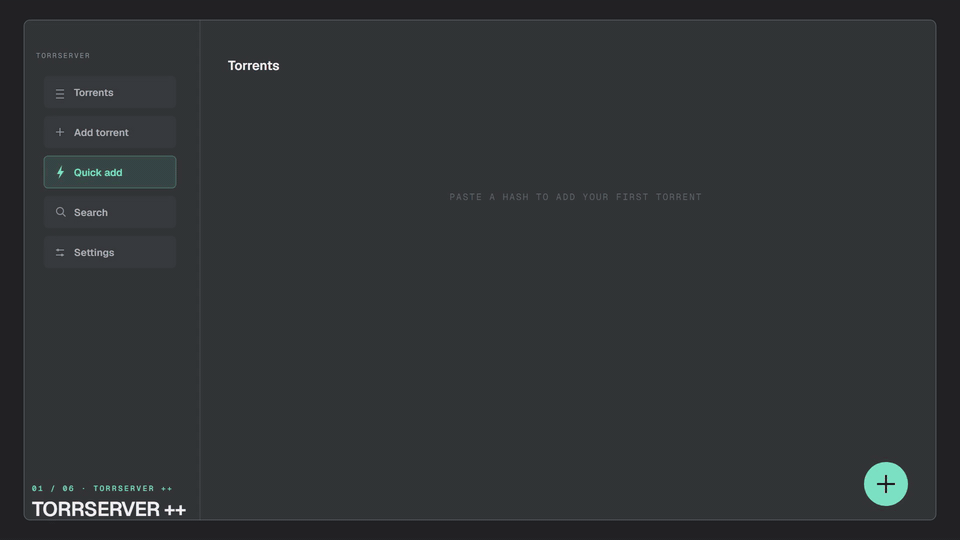

# TorrServer ++

A browser userscript that sits on top of the original [TorrServer web UI](https://github.com/yourok/torrserver) and leaves its own layout alone. The drawer, the rail and the card grid stay simple. TorrServer ++ adds the shortcuts that matter: copy a playlist or open it in MPV from the card, browse the torrent's files in a tree inside the details dialog, play a whole season, mark episodes watched, and build a playlist from any picked set.

## The design

There is no added top bar and no sort-and-arrange panel in the sidebar. The original TorrServer navigation is the navigation:

- the left rail and drawer switch between All, Movies, Series, Music, Other and Uncategorized;
- the cards keep their native Details / Playlist or Play / Drop / Delete buttons;
- the script adds **Copy link** and **MPV** above the native buttons;
- clicking anywhere on a card (poster, title, size row) opens Details with the file tree;
- the details dialog gets a file tree on the left, not another page or overlay.

The default skins, colors and layout are left alone. Only the buttons, the MPV launcher, the details tree and the small privacy dock are added.

## What changed in this pass

- The old 1.9 layout is the base: native rail, drawer, card grid and details file tree. No top bar and no Sort & arrange section.
- The details file-tree header is compact: title and counts on one line, last/next episode plus Resume on the next, and the Expand / Collapse / Folders / Select / eye controls below it.
- Right-click episode lists open at the mouse pointer. They flip up or left near the window edge.
- Every script-added control now uses one Lucide-style line-icon set: card Copy/MPV, tree actions, season actions, watch shelf, quick add, FABs, launcher and privacy panel.
- A fast MPV launcher shows immediately on click, prewarms the first file on hover, and reports peers, speed, buffered status and elapsed time. If MPV is slow, it offers Copy link and Try again instead of leaving you wondering.
- The floating plus and clipboard buttons hide while a details dialog is open, so they no longer cover the tree or the cache panel. They come back when the dialog closes.
- Below 1280 px the tree stacks under the dialog content instead of squeezing the poster and cache panels.
- Privacy mode adds a shield button that blocks public trackers, cover lookups, external poster images and `save_to_db`.

## Card buttons

| Button | Left click | Right click |
|---|---|---|
| **Copy link** | copies the playlist (`.m3u`) link | opens the episode list at the mouse pointer, copies the picked episode's direct link |
| **MPV** | plays the playlist in MPV | opens the episode list at the mouse pointer, plays the picked episode |
| **MPV** (details dialog) | plays that file | |

Right-click menus are positioned at the cursor and flip up or left when they would leave the window. A folder name appears above its group of files, so a multi-folder torrent reads like a small file browser. Click outside or press `Esc` to close.

## Fast MPV launcher

Clicking MPV no longer leaves a silent pause while the player starts:

- A small dark launcher appears immediately with the poster, title and status.
- Moving over an MPV button prewarms the first file, so a large torrent is already fetching when you click.
- Once the handler is called, the launcher reports peer count, download speed, buffered status and elapsed time.
- If nothing opens, it changes to **MPV is taking a while** and shows **Copy link** and **Try again** instead of staying silent.
- It closes itself after MPV opens or after 30 seconds; `Esc`/Close dismisses it.

The launcher never blocks the click and does not add a toolbar.

## Details file tree

Open **Details** on a card. The native dialog now has a resizable **Files** tree on its left side:

- **Folders or Seasons.** The default view groups an episode pack into season rows. Switch to **Folders** to see the real directory tree.
- **Season header.** Each season has its own **select all**, **mark watched**, **copy season playlist** and **play the whole season in MPV** buttons, with an `x/y watched` counter.
- **Episode row.** Each file has **mark watched**, **copy direct stream link** and **open in MPV**. Watched files are ticked and dimmed.
- **Select.** Turn on Select to add checkboxes. The bar above the list shows the picked count and size, with **Copy playlist**, **Play in MPV**, **Mark watched**, **Unwatch** and **Clear**.
- **Pick a season.** The season's select-all button picks exactly that season; the selection bar then builds a link for that set.
- **Resume.** When the torrent has watched marks, the tree header shows the last watched episode, the next one and a **Resume** button that starts after the last watched episode.
- **Filters.** The eye buttons switch media-only and auto-mark; hover for their tooltips. **Expand** and **Collapse** work on the folder tree.
- **Resize.** Drag the vertical divider to give the tree more or less width. On narrow screens the tree stacks under the dialog content.

The native **Download Playlist** buttons in the dialog still work: **FULL** downloads the whole playlist and **FROM LATEST FILE** starts at the file TorrServer recorded.

## Continue watching

A shelf above the card grid shows what you were watching:

- the last watched torrent or the next unwatched episode, with **Resume**;
- a **Play** button for the next episode in the browser;
- watched torrents offer **Rewatch**;
- a collapse button hides the shelf.

The shelf uses TorrServer's `/viewed` records. If a torrent has no watched mark, it is not shown.

## Quick add

Paste any text containing info hashes, `magnet:` links or `.torrent` links:

- the floating **+** opens the quick-add dialog; the clipboard button in the same dock adds straight away;
- hashes become magnets with the tracker list appended (unless privacy mode is on), duplicates are detected, and the files are added to your TorrServer;
- the category (Movies / Series / Music / Other) is detected from the name and file list;
- **Auto: clean name & fetch cover** waits for metadata, renames the torrent and finds a poster. This also repairs torrents already on the server: re-paste a hash and the name and cover refresh.

Cover sources, in order: TMDB when the server has an API key, IMDb, AniList, TVMaze, iTunes, Deezer and Wikipedia. Lookups send the cleaned title without cookies.

## MPV playback

The MPV buttons need [mpv-handler](https://github.com/akiirui/mpv-handler) installed and registered on the machine running the browser. Without it, clicking MPV does nothing.

- Left click on a card's MPV plays the playlist through the fast launcher.
- Right click opens the episode list at the pointer; pick one file to play it directly.
- In the details tree, each file has its own MPV button.
- The Resume button starts after the last watched episode using TorrServer's `fromlast` playlist.
- The launcher's **Copy link** copies the plain stream URL when the handler is missing or slow.
- The default config works with mpv-handler v0.4 and newer. For older versions set `MPV_SCHEME = 'legacy'` in the config block at the top of the script.

## Watched marks

Watched marks are saved on your TorrServer through `/viewed`, the same place the web UI keeps playback progress. They survive restarts and show up in the details tree and the continue shelf. The tree's **Auto** option marks an episode when you start it; the season check marks a whole season at once.

## Install

1. Install [Tampermonkey](https://www.tampermonkey.net/) (Chrome, Edge) or [Violentmonkey](https://violentmonkey.github.io/) (Firefox).
2. Install the script from Greasy Fork: https://greasyfork.org/en/scripts/598825-torrserver, or from the `.user.js` file in this repository.
3. Open your TorrServer page. The script activates once the UI loads.

The script matches `localhost:8090` and any other host on port `8090`. If your server runs on a different port, edit the `@match` lines at the top of the script.

## Privacy mode

The shield button above the clipboard/paste dock opens a compact privacy panel. It is a local switch for this browser:

- **No public trackers.** Bare hashes become plain magnets; pasted magnet links are stripped of `tr=` entries.
- **No cover lookups.** TMDB, IMDb, AniList, TVMaze, iTunes, Deezer and Wikipedia are skipped. Clean-name and category detection still work locally.
- **No `save_to_db`.** New torrents are added with `save_to_db: false`, so they are not written to the server database.
- **No external posters.** External `` sources are replaced with a local placeholder; the tab makes no image request. Turning privacy off restores the images that are still on the page.
- **Tracker tags removed.** Firebase, gtag, Google Analytics and similar third-party scripts are removed when found.

The switch is saved in `localStorage` and is off by default. It does not change the TorrServer process: binding to `127.0.0.1`, using `--httpauth`, and putting the server behind a TLS tunnel are server-side jobs.

## Security

The script's network boundary is your own TorrServer. Cover lookups go out with `anonymous: true` and no cookies. Clipboard reads stay local. For the server itself:

- bind it to `127.0.0.1` unless it is behind a tunnel;
- use `--httpauth` with an `accs.db`;
- do not expose the torrent port publicly;
- run it as a user that cannot read unrelated files.

Privacy mode reduces what the page leaks; it is not a replacement for binding and authenticating the server.

## Privacy

- The script reads the clipboard locally so the paste button can light up. Clipboard content never leaves your machine.
- Torrents are posted only to your own TorrServer.
- Watched marks are saved only to your own TorrServer through `/viewed`.
- Poster lookups send the cleaned release title to TMDB, IMDb, AniList, TVMaze, iTunes, Deezer or Wikipedia. The requests carry no cookies.
- No analytics, no ads, no tracking, no accounts.

## Troubleshooting

- **No file tree in Details** - the tree is added after the dialog opens; give it a moment. If it never appears, make sure you are on the TorrServer page itself and that the script is enabled.
- **The episode list opens in the wrong place** - it follows the mouse pointer and flips when it reaches the window edge. Click outside it, then right-click the button again.
- **MPV click does nothing** - check the launcher: if it says "MPV is taking a while", mpv-handler is not installed or not registered. Reinstall it and restart the browser, or use **Copy link**.
- **The launcher shows 0 peers** - the prewarm may still be connecting; wait a few seconds or press **Try again**.
- **A poster disappeared** - privacy mode replaces external images with a local placeholder. Turn the shield off to restore them.
- **The tree has two eye buttons** - the filled eye is auto-mark-watched, the crossed eye is the media-only filter; hover each for its tooltip.
- **The floating button never lights up** - browsers block clipboard reading on plain HTTP. Allow the "see text copied to the clipboard" permission, or open Quick add and press `Ctrl+V`.
- **A torrent has no season rows** - the files do not look episodic. Switch the tree to **Folders** to browse the raw paths.
- **Resume starts in the wrong place** - TorrServer's last watched record is used; check the episode's watched mark in the tree.
- **Dialog Copy link is not recoloured** - your UI language is not in the label list (English, Bulgarian, French, Romanian, Russian, Ukrainian, Chinese). Everything else works regardless.

## License

MIT. See [LICENSE](LICENSE).
